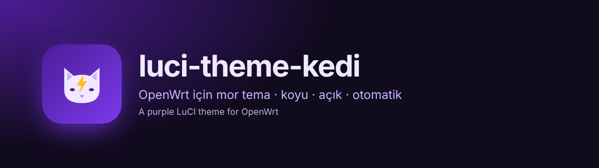
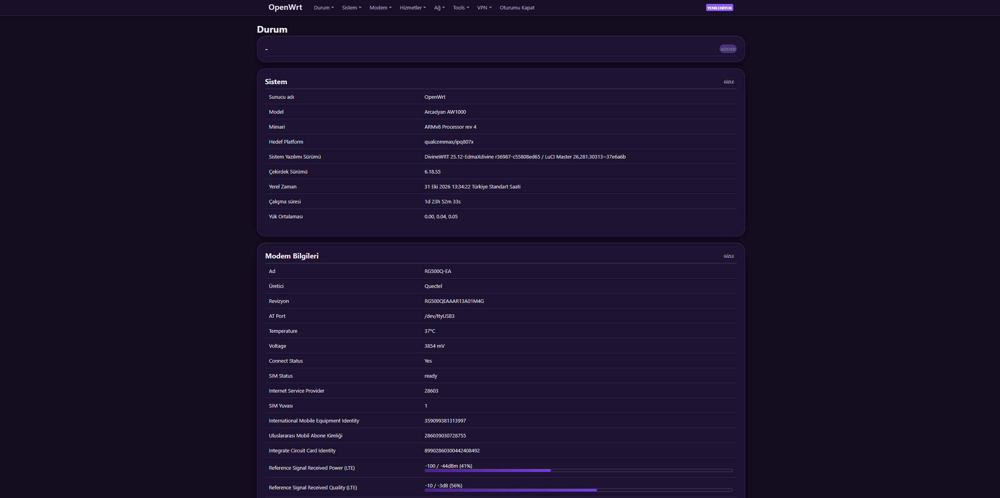
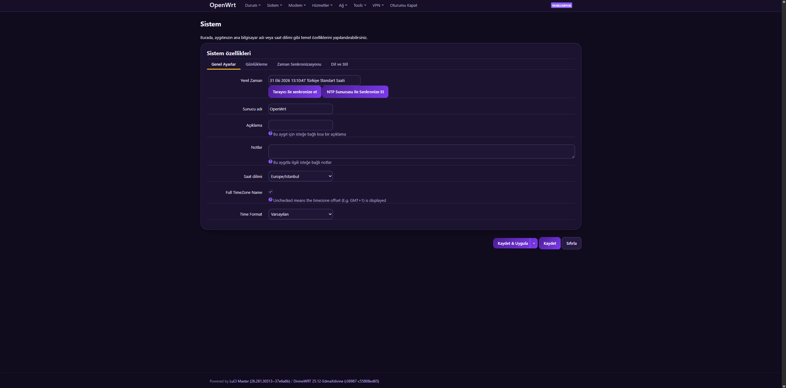
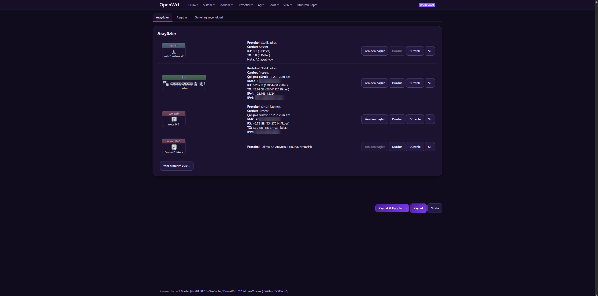
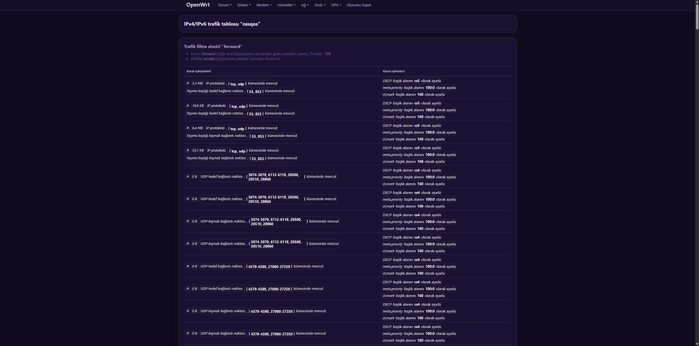
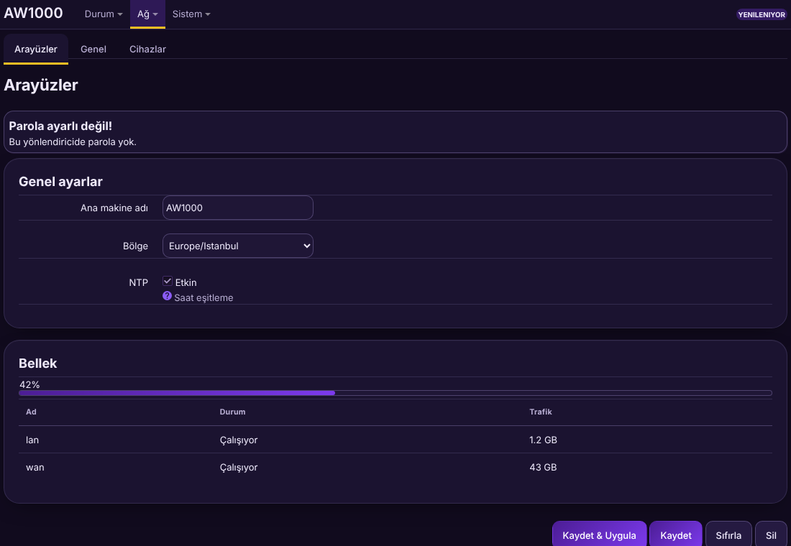
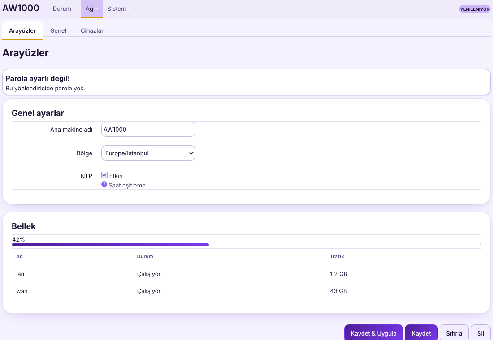
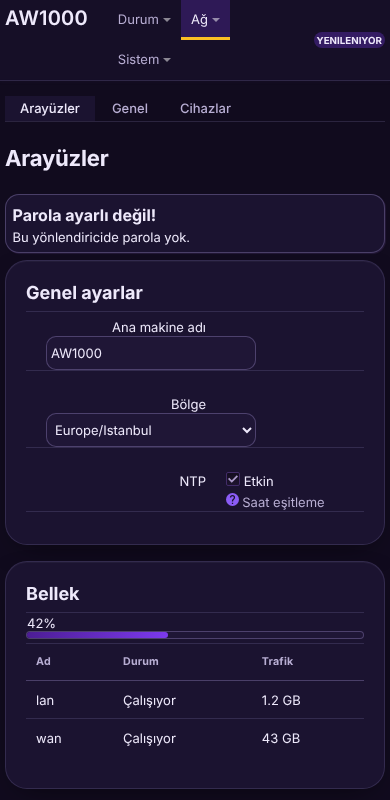
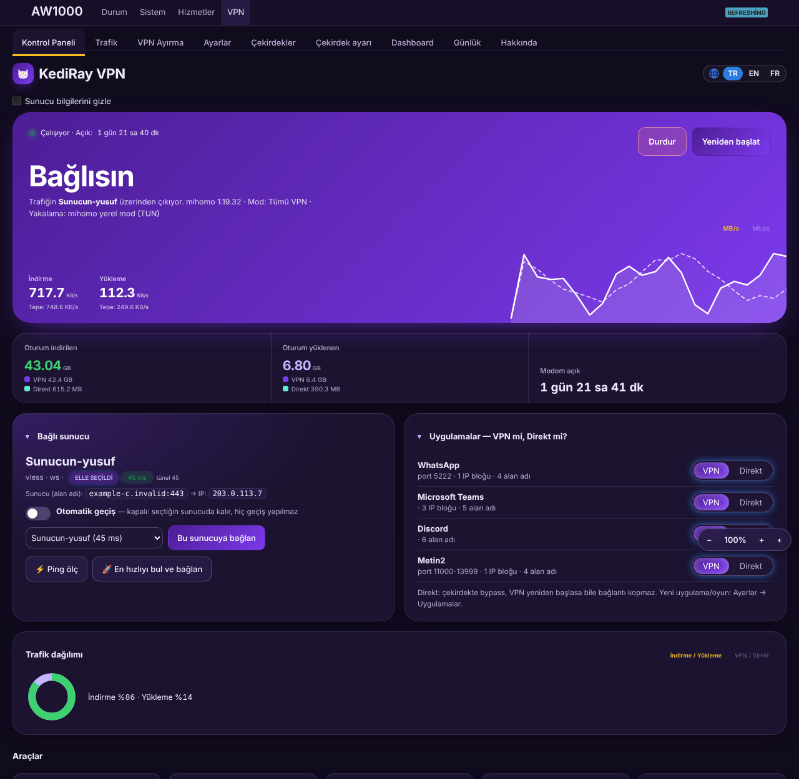

<p align="center"><a href="https://buymeacoffee.com/sabanvurgun"></a></p>
<p align="center"></p>

# luci-theme-kedi

**Türkçe** · [English](#english)

OpenWrt LuCI için mor **Kedi** teması. Koyu, açık ve otomatik (sistem teması) görünüm; telefonda da rahat kullanılır. Ağ, Güvenlik Duvarı, Sistem ve giriş ekranı dahil **tüm LuCI sayfalarına** uygulanır. [KediRay](https://github.com/sabanvurgun03-ui/kediray) ile aynı renk ailesini kullanır, ama ondan bağımsızdır: KediRay kurulu olmasa da çalışır.

## Özellikler

- Mor Kedi paleti, yuvarlak köşeli kartlar, okunaklı tablolar ve formlar
- Koyu / açık / otomatik; otomatik mod tarayıcının ya da sistemin temasını izler
- Telefon ve dar ekranlarda uyumlu yerleşim
- Giriş ekranı ve açılır pencereler dahil tüm LuCI sayfaları
- Ek paket ya da servis yok: yalnızca CSS ve LuCI şablonları, çalışırken RAM/CPU kullanmaz
- Tek komutla kurulur, tek komutla eski temaya döner

## Ekran görüntüleri

<p align="center"></p>

*Gerçek bir AW1000 modemde Durum sayfası (koyu tema).

<p align="center"></p>

*Sistem ayarları: sekmeler, form alanları, birincil düğmeler.*

<p align="center"></p>

*Ağ arayüzleri.

<p align="center"></p>

*Yoğun tablolar da okunaklı: nftables trafik tablosu.*

<p align="center"></p>

*Koyu tema (örnek LuCI sayfası: form, uyarı, ilerleme çubuğu, tablo, düğmeler).*

<p align="center"></p>

*Açık tema.*

<p align="center"></p>

*Telefon görünümü.*

<p align="center"></p>

*KediRay ile birlikte (isteğe bağlı): Kontrol Paneli.*

> Önizlemeler örnek verilerle hazırlanmıştır.

## Gereksinimler

- OpenWrt **23.05 veya üstü** (ucode tabanlı LuCI)
- Modeme SSH ya da yönetici sayfasından terminal erişimi

## Kurulum

1. [Releases](../../releases) sayfasından **`luci-theme-kedi-install.sh`** dosyasını indir.
2. Modeme gönder (bilgisayarından):
   ```sh
   scp luci-theme-kedi-install.sh root@192.168.1.1:/tmp/
   ```
3. Modemde çalıştır:
   ```sh
   sh /tmp/luci-theme-kedi-install.sh
   ```
4. Tarayıcıda LuCI sayfasını **Ctrl+Shift+R** ile yenile. Tema etkin olur.

Etkinleştirmeden kurmak için: `sh luci-theme-kedi-install.sh --no-activate`, sonra **Sistem → Görünüm → Tema: Kedi**.

## Kaldırma

```sh
sh /tmp/luci-theme-kedi-install.sh --remove
```

Önceki tema geri yüklenir (kayıt yoksa Bootstrap), tema dosyaları silinir.

## Koyu / açık seçimi

Varsayılan **otomatik**. Elle seçmek için KediRay sayfalarındaki sağ alttaki tema düğmesini (🌙 ☀️ ◐) kullan; seçim tarayıcıda saklanır ve tüm LuCI için geçerlidir.

## Sorun giderme

- **Tema görünmüyor:** Sayfayı Ctrl+Shift+R ile yenile; olmazsa tarayıcının önbelleğini temizle ya da gizli sekmede aç.
- **Sayfa açılmıyor ya da bozuk:** `sh luci-theme-kedi-install.sh --remove` ile eski temaya dön ve hatayı Issues'a yaz.
- **Giriş ekranı eski görünüyor:** Tema etkinse giriş ekranı da değişir; önbelleği temizle.

## Derleme

```sh
python3 src/build.py     # luci-theme-kedi-install.sh üretir
```

`src/` klasörü OpenWrt kaynak ağacında `Makefile` ile paket (`luci-theme-kedi`) olarak da derlenebilir.

## Lisans

Apache-2.0 (LICENSE). Tema, LuCI'nin Bootstrap temasından türetilmiştir; telif hakları ilgili sahiplerine aittir. Kedi renkleri ve düzeni: © 2026 Şaban Vurgun.

---

## English

A purple **Kedi** theme for OpenWrt LuCI. Dark, light and auto (follows your system), phone-friendly. It applies to **every LuCI page**, including Network, Firewall, System and the login screen. It shares its colours with [KediRay](https://github.com/sabanvurgun03-ui/kediray) but is independent: it works without KediRay.

### Features

- Purple Kedi palette, rounded cards, readable tables and forms
- Dark / light / auto (auto follows the browser or system theme)
- Responsive layout for phones and narrow screens
- Login screen and dialogs included
- No extra packages or services: CSS and LuCI templates only, no RAM/CPU use at runtime
- One command to install, one to go back

### Screenshots

See the images above: Status, System, Network and traffic-table pages on a real AW1000 router (dark; identifiers blurred), plus dark, light, phone and KediRay previews. Previews use sample data.

### Requirements

- OpenWrt **23.05 or newer** (ucode-based LuCI)
- SSH or terminal access to the router

### Install

1. Download **`luci-theme-kedi-install.sh`** from [Releases](../../releases).
2. Copy it to the router:
   ```sh
   scp luci-theme-kedi-install.sh root@192.168.1.1:/tmp/
   ```
3. Run it on the router:
   ```sh
   sh /tmp/luci-theme-kedi-install.sh
   ```
4. Hard-refresh LuCI in your browser (**Ctrl+Shift+R**). The theme is active.

To install without activating: `sh luci-theme-kedi-install.sh --no-activate`, then **System → Style → Theme: Kedi**.

### Remove

```sh
sh /tmp/luci-theme-kedi-install.sh --remove
```

The previous theme is restored (Bootstrap if none was saved) and the theme files are deleted.

### Dark / light

Default is **auto**. To pick manually, use the theme button at the bottom right of KediRay pages (🌙 ☀️ ◐); the choice is stored in the browser and applies to all of LuCI.

### Troubleshooting

- **Theme not showing:** hard-refresh (Ctrl+Shift+R), clear the browser cache, or open in a private window.
- **Page broken or blank:** run `sh luci-theme-kedi-install.sh --remove` to go back and open an issue.

### Build

```sh
python3 src/build.py     # produces luci-theme-kedi-install.sh
```

### License

Apache-2.0 (LICENSE). Derived from LuCI's Bootstrap theme; copyrights belong to their owners. Kedi colours and layout: © 2026 Şaban Vurgun.

<p align="center"><a href="https://buymeacoffee.com/sabanvurgun"></a></p>
